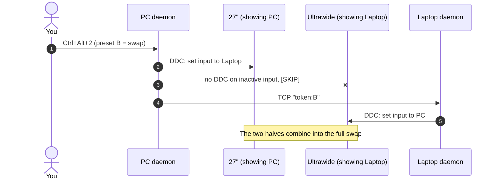

# ddc-switch

[](https://github.com/selfishhuman/ddc-switch/actions/workflows/ci.yml)


[](LICENSE)

**Global hotkeys that switch which computer each monitor shows, using DDC/CI over the video cables
you already have.** Pure PowerShell with no third-party software. It uses the Windows `dxva2`
Monitor Configuration API, `RegisterHotKey`, and plain TCP so two machines can coordinate.

<!-- TODO: demo GIF of the monitors switching -->

## Why this exists
I run a desktop PC and a laptop on two monitors (a 34" ultrawide and a 27"), with a USB KVM
(CM662) switching the keyboard, mouse and speakers. The KVM doesn't switch video, so I wanted
hotkeys that do: *put the laptop on the ultrawide*, *swap them*, *send everything to the PC*.

DDC/CI lets software change a monitor's input over the existing cable. The catch: **these monitors
only accept DDC commands on the input they're currently showing.** The machine whose keyboard
you're using can't command a monitor that is displaying the other machine, so a single-machine tool
can't do a swap.

So ddc-switch runs a small **daemon on both machines**. Each one switches only the monitors it
currently owns and forwards the preset to its peer, which switches the rest:



Neither machine ever needs DDC on an inactive input, and the same hotkey works from either keyboard.
The design notes and hardware findings (flicker, failure modes) are in [docs/DESIGN.md](docs/DESIGN.md).

## Features
- **Presets**: side-by-side, swapped, or classic KVM (both monitors to one machine), or any mix you define.
- **Monitor settings**: brightness, contrast, picture mode, colour temperature, RGB gains and
  volume, from hotkeys, the CLI or the wheel. They're coordinated the same way as presets, so they
  reach a monitor whichever machine it's showing.
- **Radial wheel**: hold `Ctrl+Alt+Space` for a GTA-style weapon wheel. Point at a slice and let go.
- **Reading toggle**: one key switches to the monitor's reading mode, and the next key puts back
  exactly what you had.
- **Saved looks**: tune each monitor by eye, then `ddc.ps1 save Day` (or *Looks → + Save current* on
  the wheel) stores every setting of both monitors. Recall it with one slice, hotkey or command.
- **Linked brightness**: `ddc.ps1 calibrate` has you match the two panels by eye at dim, middle and
  bright. After that, brightness uses one shared 0–100 scale: a step looks the same on both, and both
  reach their minimum together.
- **Responsive hotkeys**: holding `Ctrl+Alt+Up/Down` repeats. Presses that queue up during a DDC
  write are merged into one step, so spamming or holding doesn't build up a backlog.
- **Safe by design**: only a fixed list of settings can ever be written, and only the ones a monitor
  advertises. Values are range-checked, and nothing can power off or factory-reset a monitor.
- **Config-driven**: monitors are matched by aspect ratio or resolution rules; inputs, presets and
  hotkeys all live in one `.psd1` file.
- **Flicker-aware**: skips monitors already on the target input, so nothing re-handshakes needlessly.
- **Graceful degradation**: works single-machine for the monitors that machine owns; logs every action.
- **Hardened peer link**: shared-token auth, peer-address allow-list, receive timeout, and
  refuses to listen while the token is still a placeholder.
- **Tested**: Pester unit tests run without any monitors, plus PSScriptAnalyzer, both in CI.

## Requirements
- Windows 10/11 with Windows PowerShell 5.1 (built in) or PowerShell 7.
- Monitors with **DDC/CI enabled** in their OSD.
- Each machine **physically cabled** to each monitor's own input. DDC only picks which input is shown.
- For two-machine use: the machines can reach each other over TCP (same LAN, or [Tailscale](https://tailscale.com)).

## Quick start
Do this on **both** machines.

1. **Get the files.** Clone or download this repo.
2. **See your monitors.**
   ```powershell
   powershell -ExecutionPolicy Bypass -File ddc.ps1 list
   ```
   This shows each monitor's resolution, aspect ratio, current input code and DDC status.
3. **Create your config.** Copy `config.example.psd1` to `config.psd1`, then:
   - Edit `Monitors` so each rule matches one of your monitors (see [Configuration](#configuration)).
   - Capture the input codes. With both monitors showing the PC, run `ddc.ps1 capture PC`. With both
     showing the laptop, run `ddc.ps1 capture Laptop` there. Copy the printed codes into `Monitors`.
   - Set `Network.Token` to a random secret (instructions in the file). Use the **same `config.psd1`
     on both machines**.
4. **Point each machine at the other.** Copy `machine.local.example.psd1` to `machine.local.psd1`
   and set `PeerHost` to the **other** machine's IP or hostname (a Tailscale IP is most reliable).
5. **Install autostart.**
   ```powershell
   powershell -ExecutionPolicy Bypass -File install-startup.ps1
   ```
   This registers a scheduled task, *DDC Switch Hotkeys*. It runs as you, not elevated, and starts the
   daemon at sign-in, on unlock and on resume from sleep. A daemon that died comes back the next time
   you unlock; when one is already running, the new copy exits. Run the installer **as admin** to open
   the firewall port automatically. Otherwise, click *Allow (Private networks)* on the one-time
   Windows Firewall prompt. Nothing runs at the lock / sign-in screen.
6. **Test.** Press a hotkey and check `ddc-hotkeys.log` on both machines. You should see
   `Hotkey ... (local)` on the machine you pressed it on and `[peer] applied ...` on the other.

## Configuration
`config.psd1` (shared, identical on both machines):

```powershell
Monitors = @(   # ordered: first matching rule names the monitor
    @{ Name = 'X340 PRO';  Match = @{ MinAspect = 2.0 }; PC = 0x08; Laptop = 0x05 }   # ultrawide
    @{ Name = 'F270i PRO'; Match = @{};                  PC = 0x0F; Laptop = 0x11 }   # fallback
)
Presets = @{
    'A' = @{ 'X340 PRO' = 'Laptop'; 'F270i PRO' = 'PC' }
    'B' = @{ 'X340 PRO' = 'PC';     'F270i PRO' = 'Laptop' }
}
Hotkeys = @(
    @{ Keys = 'Ctrl+Alt+1'; Preset = 'A' }
    @{ Keys = 'Ctrl+Alt+2'; Preset = 'B' }
)
Network = @{ Port = 58762; Token = '<random 16+ chars>'; RestrictToPeer = $true }
```

| Setting | Notes |
|---|---|
| `Match` | `MinAspect`, `MaxAspect`, `Width`, `Height`. Every criterion you give must pass. An empty `@{}` matches anything. |
| Side keys (`PC`, `Laptop`, …) | Any name. The value is the monitor's VCP `0x60` input code for that machine. |
| `Hotkeys.Keys` | Modifiers `Ctrl` `Alt` `Shift` `Win` + one key: `A–Z`, `0–9`, `F1–F24`, `Space`, `Up`, `Down`, `Left`, `Right`, `PageUp`, `PageDown`. |
| `Hotkeys.Action` | A preset name, `Wheel`, or a settings action (below). Older configs' `Preset = ...` still works. |
| `PictureModes` / `ColorTemps` (per monitor) | Name → value map for VCP `0xDC` / `0x14`, using the names the monitor's OSD shows. These also become the wheel's choices. |
| `Codes` (per monitor) | Move a feature to a vendor VCP code, e.g. `@{ PictureMode = 0xE0 }`. Only use a code you've tested while watching the OSD. |
| `Profiles` | Named sets of settings. `Reading` is toggled; `Normal` is the fallback when there's nothing to restore. |
| `PresetLabels` | Optional friendlier preset names for the wheel. |
| `Network.RestrictToPeer` | Only accept connections from this machine's `PeerHost`. |

Common VCP `0x60` codes are `0x0F` DP1, `0x10` DP2, `0x11` HDMI1 and `0x12` HDMI2, but vendors
vary (the X340 uses `0x08`/`0x05`). Trust `capture`.

### Settings actions
Hotkeys, the wheel and the peer link all carry the same action strings:

| Action | Example |
|---|---|
| `Set:<Feature>=<Value>[@<Monitor>]` | `Set:Brightness=+10`, `Set:Contrast=60%`, `Set:PictureMode=Movie@X340 PRO`, `Set:ColorTemp=Next` |
| `Profile:<Name>[@<Monitor>]` | `Profile:Normal` |
| `Toggle:<Name>[@<Monitor>]` | `Toggle:Reading`: applies the profile and saves what it replaced; the next toggle restores it |
| `Look:<Name>[@<Monitor>]` | `Look:Day`: applies a saved look |
| `Save:<Name>` | `Save:Day`: saves the current settings of the monitors this machine shows (the peer saves its own) |

### Looks and calibration (`saved.psd1`)
`ddc.ps1 save <Name>` and `ddc.ps1 calibrate` write `saved.psd1` next to the config, so your
hand-written `config.psd1` is never rewritten. **Copy `saved.psd1` to the other machine** too: each
machine applies looks and calibration only to the monitors it's showing. Saving from the wheel is
forwarded, so the peer saves its monitors under the same name.

`calibrate` needs every monitor showing the machine you run it on (press `Ctrl+Alt+P` first) and an
interactive terminal. At three steps (dim, middle, bright), pick a monitor with Tab, adjust it with
Up/Down (PageUp/PageDown = ±5) until both look equally bright, then press Enter. Your brightness is
put back afterwards. `ddc.ps1 forget calibration` removes it.

Features: `PictureMode`, `ColorTemp`, `Brightness`, `Contrast`, `RedGain`, `GreenGain`, `BlueGain`,
`Volume`, `Mute`. Values can be absolute (`40`), a percentage (`40%`) or relative (`+10`, `-10`).
List features take a name, or `Next` / `Prev` to cycle. Without `@<Monitor>`, an action applies to
every monitor. Each machine changes only the monitors it's currently showing, and the peer does the rest.

Safety rules, enforced in `Set-MonitorFeature`:
- Only the features above can be written. Power (`0xD6`), factory reset (`0x04`) and similar codes are never sent.
- A feature is used only if the monitor's capabilities string advertises its code.
- List values must be ones the monitor advertises (or that you named in config). Ranges are clamped to the monitor's max.
- Unchanged values aren't re-sent (except picture mode, which some monitors misreport).
- Writes are spaced out, as MCCS requires.

## Wheel
Hold **`Ctrl+Alt+Space`**. A dimmed overlay with a radial menu appears on the monitor under your mouse.
- **Hold, point, release** picks the slice you're pointing at. **Tap** the hotkey instead to keep it open and click.
- Slices: Layout (presets), Looks, Brightness, Colour temp, Reading, Profiles. Contrast, picture mode,
  volume and mute are left off (unsupported or counter-productive on these monitors) but still work
  as hotkey and `ddc.ps1` actions.
- With target **All**, Colour temp offers only the choices every monitor has. Target a single monitor
  to see all of its own presets.
- **Scroll** over Brightness (or anywhere inside its submenu) to adjust in steps of 5.
- **Click the centre** to choose which monitor settings apply to (All / each monitor).
- **Right-click** or Backspace goes back. Esc, clicking off or the hotkey again closes it.
- Below the wheel: live values for this machine's monitors and the result of the last change.

Settings slices stay open so you can keep tuning. Layout and Reading close the wheel when picked.
`ddc.ps1 wheel` opens it from a terminal for testing; that version is local only, with no forwarding.

## CLI
```powershell
ddc.ps1 list                      # monitors, resolution, aspect, current input, DDC status
ddc.ps1 preset <Name>             # apply a preset (to the monitors this machine owns)
ddc.ps1 set "<Monitor>" 0x11      # send a raw input code (hex or decimal)
ddc.ps1 capture <Side>            # print current inputs as <Side>'s codes and diff them against config
ddc.ps1 list -ConfigPath other.psd1

ddc.ps1 status                    # brightness, contrast, picture mode, colour temp, volume per monitor
ddc.ps1 caps ["<Monitor>"]        # raw capabilities + which features/values each monitor supports
ddc.ps1 brightness 40 ["<Monitor>"]   # also: contrast, volume (40, 40%, +10, -10)
ddc.ps1 mode Movie ["<Monitor>"]      # picture mode by name, or Next / Prev
ddc.ps1 colortemp 6500K ["<Monitor>"]
ddc.ps1 reading ["<Monitor>"]     # toggle the Reading profile
ddc.ps1 profile <Name> ["<Monitor>"]
ddc.ps1 do "<Action>"             # any action string
ddc.ps1 wheel                     # open the wheel here (local only)
```
The CLI only changes monitors on this machine's active inputs. Hotkeys and the wheel also forward to the peer.

## Restarting the daemon
The daemon loads its engine, hotkeys and network settings at startup. Presets and input codes are
re-read on every press. After changing code or hotkeys:
```powershell
powershell -ExecutionPolicy Bypass -File install-startup.ps1 -Remove   # stops the daemon, removes autostart
powershell -ExecutionPolicy Bypass -File install-startup.ps1           # reinstalls and starts it
```
If the daemon was started elevated, run these from an elevated shell.

## Troubleshooting
| Symptom | Cause / fix |
|---|---|
| Log shows `[SKIP] <monitor> not connected / no DDC` | Expected when the monitor is showing the other machine; the peer handles it. If it's skipped on **both** machines, DDC/CI is off in the OSD or the monitor is asleep. |
| `could not reach peer ...` | Check `PeerHost`, that both daemons are running, the firewall port, and that `Token`/`Port` match. |
| `[peer] rejected connection from ...` | The connection didn't come from `PeerHost`. Fix `PeerHost` on the receiving machine. |
| `Network=OFF` in the log | `Network.Token` is still the placeholder or too short. |
| `FAILED to register Ctrl+Alt+...` | Another app owns that hotkey. Pick different `Keys`. |
| Monitor shows `(unmatched)` | No `Match` rule fits. Compare with `ddc.ps1 list` output. |
| Wrong input after a cable change | Re-run `ddc.ps1 capture <Side>`. |
| A setting shows `not supported by this monitor` | The monitor doesn't advertise that VCP code. Check `ddc.ps1 caps`. |
| `Status` shows the wrong picture mode | Some monitors misreport it (the X340 reads Reading back as Standard). Picture mode is always re-sent, so setting it still works. |
| Peer logs `error applying 'Set:...'` / `Preset 'Set:...' not found` | The other machine still runs an older version. Update both machines. |

## Security model
- The peer link is **authenticated by a shared token but not encrypted**. Anyone who can sniff
  the traffic can see the token. Run it over **Tailscale** (WireGuard-encrypted) or a LAN you
  trust, not across the internet.
- Worst case, someone who gets the token **and** can reach the port from `PeerHost`'s address
  can switch your monitor inputs or change picture settings. The protocol carries only an action
  string. Nothing is executed, and unknown presets, profiles, features and monitors are rejected.
  Settings go through the same whitelist and range checks as local ones, so the peer link can't
  power off or reset a monitor.
- The firewall rule created by `install-startup.ps1` allows the port on **Private/Domain**
  networks only, and the daemon won't listen until you set a real token.
- `config.psd1`, `machine.local.psd1` and logs are git-ignored, so your token and addresses stay
  out of version control.

## Development
```powershell
Install-Module Pester -MinimumVersion 5.5.0 -Scope CurrentUser
Install-Module PSScriptAnalyzer -Scope CurrentUser
Invoke-Pester tests
Invoke-ScriptAnalyzer -Path . -Recurse -Settings PSScriptAnalyzerSettings.psd1
```

| File | Purpose |
|---|---|
| `ddc-lib.ps1` | Engine: enumerate monitors, match rules, capabilities, presets, settings + safety checks, profiles, actions, hotkey parsing |
| `ddc-wheel.ps1` | Radial wheel overlay (WPF, compiled at startup) and its menu |
| `ddc.ps1` | CLI |
| `ddc-hotkeys.ps1` | Daemon: hotkeys, wheel, peer listener, forwarding, single-instance guard |
| `start-hotkeys.vbs` | Launches the daemon without a console window |
| `install-startup.ps1` | Scheduled-task autostart (sign-in / unlock / wake), firewall rule, uninstall |
| `config.example.psd1` / `machine.local.example.psd1` | Templates for the git-ignored real configs |

## Roadmap
- [ ] Auto-reclaim on sign-in: a machine pulls its own monitors back when it logs in, so a screen
      never stays stuck on a machine that was off.
- [x] Clickable presets and settings: the radial wheel.
- [ ] A single toggle hotkey for the side-by-side swap.
- [ ] Name the X340's picture mode `0x05` (advertised, OSD name unconfirmed).

## License
[MIT](LICENSE)
