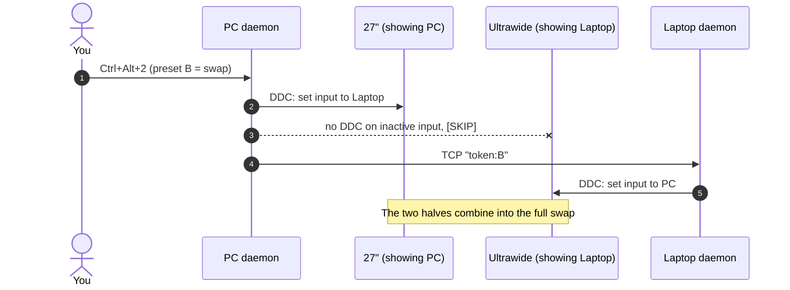

# ddc-switch

[](https://github.com/selfishhuman/ddc-switch/actions/workflows/ci.yml)


[](LICENSE)

**Global hotkeys that switch which computer each monitor shows, using DDC/CI over the video cables
you already have.** Pure PowerShell with no third-party software. It uses the Windows `dxva2`
Monitor Configuration API, `RegisterHotKey`, and plain TCP so two machines can coordinate.

<!-- TODO: demo GIF of the monitors switching -->

## Why this exists
I run a desktop PC and a laptop on two monitors (a 34" ultrawide and a 27"), with a USB KVM
(CM662) switching the keyboard, mouse and speakers. The KVM doesn't switch video, so I wanted
hotkeys that do: *put the laptop on the ultrawide*, *swap them*, *send everything to the PC*.

DDC/CI lets software change a monitor's input over the existing cable. The catch: **these monitors
only accept DDC commands on the input they're currently showing.** The machine whose keyboard
you're using can't command a monitor that is displaying the other machine, so a single-machine tool
can't do a swap.

So ddc-switch runs a small **daemon on both machines**. Each one switches only the monitors it
currently owns and forwards the preset to its peer, which switches the rest:



Neither machine ever needs DDC on an inactive input, and the same hotkey works from either keyboard.
The design notes and hardware findings (flicker, failure modes) are in [docs/DESIGN.md](docs/DESIGN.md).

## Features
- **Presets**: side-by-side, swapped, or classic KVM (both monitors to one machine), or any mix you define.
- **Config-driven**: monitors are matched by aspect ratio or resolution rules; inputs, presets and
  hotkeys all live in one `.psd1` file.
- **Flicker-aware**: skips monitors already on the target input, so nothing re-handshakes needlessly.
- **Graceful degradation**: works single-machine for the monitors that machine owns; logs every action.
- **Hardened peer link**: shared-token auth, peer-address allow-list, receive timeout, and
  refuses to listen while the token is still a placeholder.
- **Tested**: Pester unit tests run without any monitors, plus PSScriptAnalyzer, both in CI.

## Requirements
- Windows 10/11 with Windows PowerShell 5.1 (built in) or PowerShell 7.
- Monitors with **DDC/CI enabled** in their OSD.
- Each machine **physically cabled** to each monitor's own input. DDC only picks which input is shown.
- For two-machine use: the machines can reach each other over TCP (same LAN, or [Tailscale](https://tailscale.com)).

## Quick start
Do this on **both** machines.

1. **Get the files.** Clone or download this repo.
2. **See your monitors.**
   ```powershell
   powershell -ExecutionPolicy Bypass -File ddc.ps1 list
   ```
   This shows each monitor's resolution, aspect ratio, current input code and DDC status.
3. **Create your config.** Copy `config.example.psd1` to `config.psd1`, then:
   - Edit `Monitors` so each rule matches one of your monitors (see [Configuration](#configuration)).
   - Capture the input codes. With both monitors showing the PC, run `ddc.ps1 capture PC`. With both
     showing the laptop, run `ddc.ps1 capture Laptop` there. Copy the printed codes into `Monitors`.
   - Set `Network.Token` to a random secret (instructions in the file). Use the **same `config.psd1`
     on both machines**.
4. **Point each machine at the other.** Copy `machine.local.example.psd1` to `machine.local.psd1`
   and set `PeerHost` to the **other** machine's IP or hostname (a Tailscale IP is most reliable).
5. **Install autostart.**
   ```powershell
   powershell -ExecutionPolicy Bypass -File install-startup.ps1
   ```
   Run it **as admin** to open the firewall port automatically. Otherwise, click *Allow (Private
   networks)* on the one-time Windows Firewall prompt.
6. **Test.** Press a hotkey and check `ddc-hotkeys.log` on both machines. You should see
   `Hotkey ... (local)` on the machine you pressed it on and `[peer] applied ...` on the other.

## Configuration
`config.psd1` (shared, identical on both machines):

```powershell
Monitors = @(   # ordered: first matching rule names the monitor
    @{ Name = 'X340 PRO';  Match = @{ MinAspect = 2.0 }; PC = 0x08; Laptop = 0x05 }   # ultrawide
    @{ Name = 'F270i PRO'; Match = @{};                  PC = 0x0F; Laptop = 0x11 }   # fallback
)
Presets = @{
    'A' = @{ 'X340 PRO' = 'Laptop'; 'F270i PRO' = 'PC' }
    'B' = @{ 'X340 PRO' = 'PC';     'F270i PRO' = 'Laptop' }
}
Hotkeys = @(
    @{ Keys = 'Ctrl+Alt+1'; Preset = 'A' }
    @{ Keys = 'Ctrl+Alt+2'; Preset = 'B' }
)
Network = @{ Port = 58762; Token = '<random 16+ chars>'; RestrictToPeer = $true }
```

| Setting | Notes |
|---|---|
| `Match` | `MinAspect`, `MaxAspect`, `Width`, `Height`. Every criterion you give must pass. An empty `@{}` matches anything. |
| Side keys (`PC`, `Laptop`, …) | Any name. The value is the monitor's VCP `0x60` input code for that machine. |
| `Hotkeys.Keys` | Modifiers `Ctrl` `Alt` `Shift` `Win` + one key `A–Z`, `0–9`, `F1–F24`. |
| `Network.RestrictToPeer` | Only accept connections from this machine's `PeerHost`. |

Common VCP `0x60` codes are `0x0F` DP1, `0x10` DP2, `0x11` HDMI1 and `0x12` HDMI2, but vendors
vary (the X340 uses `0x08`/`0x05`). Trust `capture`.

## CLI
```powershell
ddc.ps1 list                      # monitors, resolution, aspect, current input, DDC status
ddc.ps1 preset <Name>             # apply a preset (to the monitors this machine owns)
ddc.ps1 set "<Monitor>" 0x11      # send a raw input code (hex or decimal)
ddc.ps1 capture <Side>            # print current inputs as <Side>'s codes and diff them against config
ddc.ps1 list -ConfigPath other.psd1
```

## Restarting the daemon
The daemon loads its engine, hotkeys and network settings at startup. Presets and input codes are
re-read on every press. After changing code or hotkeys:
```powershell
powershell -ExecutionPolicy Bypass -File install-startup.ps1 -Remove   # stops the daemon, removes autostart
powershell -ExecutionPolicy Bypass -File install-startup.ps1           # reinstalls and starts it
```
If the daemon was started elevated, run these from an elevated shell.

## Troubleshooting
| Symptom | Cause / fix |
|---|---|
| Log shows `[SKIP] <monitor> not connected / no DDC` | Expected when the monitor is showing the other machine; the peer handles it. If it's skipped on **both** machines, DDC/CI is off in the OSD or the monitor is asleep. |
| `could not reach peer ...` | Check `PeerHost`, that both daemons are running, the firewall port, and that `Token`/`Port` match. |
| `[peer] rejected connection from ...` | The connection didn't come from `PeerHost`. Fix `PeerHost` on the receiving machine. |
| `Network=OFF` in the log | `Network.Token` is still the placeholder or too short. |
| `FAILED to register Ctrl+Alt+...` | Another app owns that hotkey. Pick different `Keys`. |
| Monitor shows `(unmatched)` | No `Match` rule fits. Compare with `ddc.ps1 list` output. |
| Wrong input after a cable change | Re-run `ddc.ps1 capture <Side>`. |

## Security model
- The peer link is **authenticated by a shared token but not encrypted**. Anyone who can sniff
  the traffic can see the token. Run it over **Tailscale** (WireGuard-encrypted) or a LAN you
  trust, not across the internet.
- Worst case, someone who gets the token **and** can reach the port from `PeerHost`'s address
  can switch your monitor inputs. The protocol carries only a preset name: nothing is executed,
  and unknown presets are rejected.
- The firewall rule created by `install-startup.ps1` allows the port on **Private/Domain**
  networks only, and the daemon won't listen until you set a real token.
- `config.psd1`, `machine.local.psd1` and logs are git-ignored, so your token and addresses stay
  out of version control.

## Development
```powershell
Install-Module Pester -MinimumVersion 5.5.0 -Scope CurrentUser
Install-Module PSScriptAnalyzer -Scope CurrentUser
Invoke-Pester tests
Invoke-ScriptAnalyzer -Path . -Recurse -Settings PSScriptAnalyzerSettings.psd1
```

| File | Purpose |
|---|---|
| `ddc-lib.ps1` | Engine: enumerate monitors, match rules, read/set input, apply presets, parse hotkeys |
| `ddc.ps1` | CLI |
| `ddc-hotkeys.ps1` | Daemon: hotkeys, peer listener, forwarding |
| `start-hotkeys.vbs` | Launches the daemon without a console window |
| `install-startup.ps1` | Autostart at logon, firewall rule, uninstall |
| `config.example.psd1` / `machine.local.example.psd1` | Templates for the git-ignored real configs |

## Roadmap
- [ ] Auto-reclaim on sign-in: a machine pulls its own monitors back when it logs in, so a screen
      never stays stuck on a machine that was off.
- [ ] Tray icon with clickable presets.
- [ ] A single toggle hotkey for the side-by-side swap.

## License
[MIT](LICENSE)
